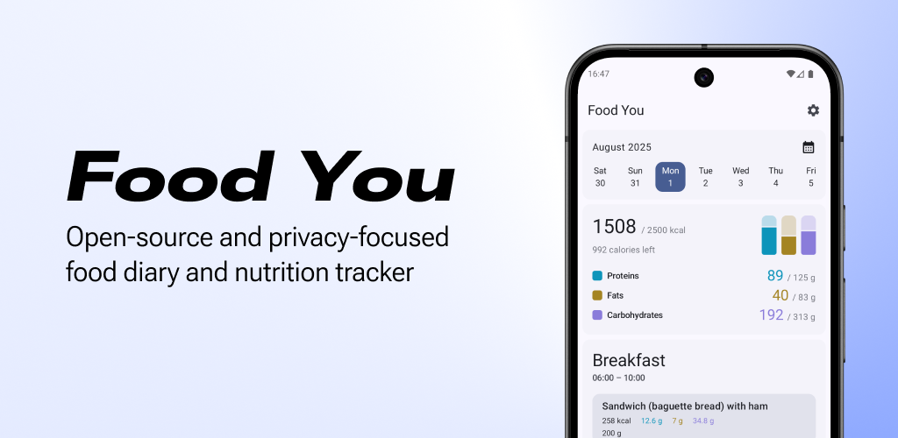
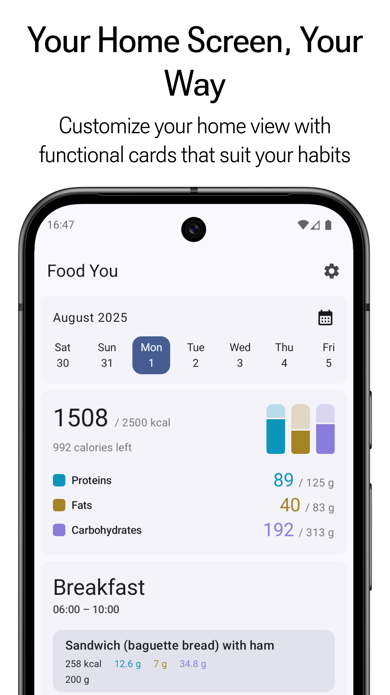
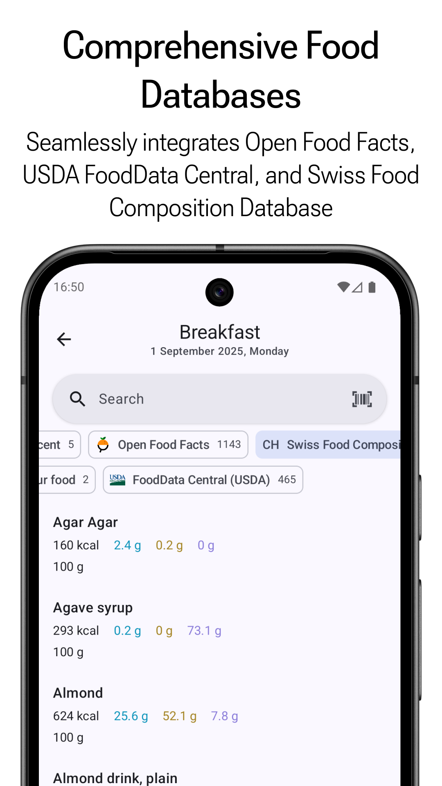
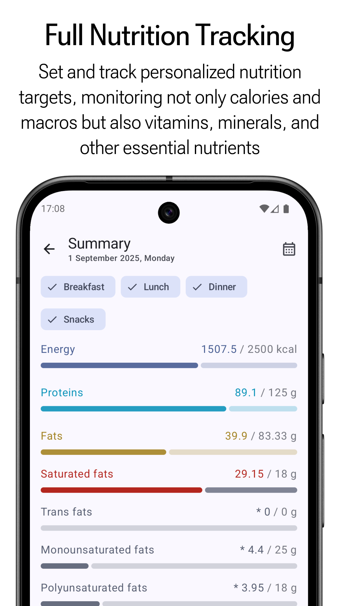
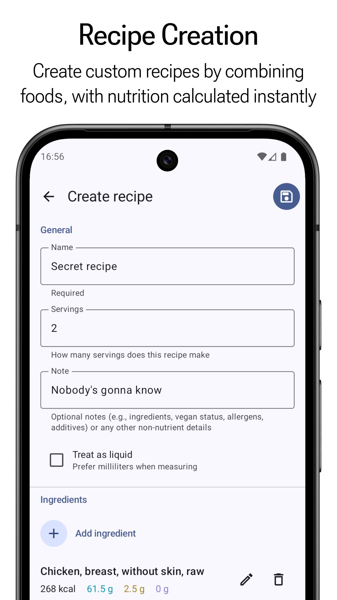

## Cambios de este fork: botón Foto IA

# FoodYou + Foto IA (Yui via Tailscale)

## Que hace
Fork de FoodYou (GPL-3.0) con boton **Foto IA** en "Quick Add".
- Camara / Galeria -> POST http://100.66.224.38:8765/analyze-food (Tailscale) -> Yui (hermes --image) -> JSON {alimento,kcal,proteinas,grasas,carbos} -> rellena formulario.

## Servidor
`voice_server.py` :8765
- GET /health, GET /analyze-food (info)
- POST /analyze-food multipart image=file (jpg/png/webp, 10MB) -> usa `hermes chat --image foto -Q` como VLM.

## Archivos modificados
- app/src/commonMain/kotlin/com/maksimowiczm/foodyou/photo/PhotoAnalyzer.kt
- app/src/commonMain/kotlin/com/maksimowiczm/foodyou/photo/KtorPhotoAnalyzer.kt (fallback URLs: 100.66.224.38 -> 192.168.10.214 -> 10.0.0.1)
- app/src/commonMain/kotlin/com/maksimowiczm/foodyou/photo/PhotoModule.kt
- app/src/commonMain/kotlin/com/maksimowiczm/foodyou/photo/PhotoAnalyzeButton.kt (expect)
- app/src/androidMain/kotlin/com/maksimowiczm/foodyou/photo/PhotoAnalyzeButton.kt (actual, camara+galeria)
- app/src/iosMain/kotlin/com/maksimowiczm/foodyou/photo/PhotoAnalyzeButton.kt (stub)
- app/src/commonMain/kotlin/com/maksimowiczm/foodyou/app/di/InitKoin.kt (+photoModule)
- app/src/commonMain/kotlin/com/maksimowiczm/foodyou/app/ui/food/diary/quickadd/QuickAddScreen.kt (boton)
- app/src/androidMain/AndroidManifest.xml (+CAMERA + networkSecurityConfig)
- app/src/androidMain/res/xml/network_security_config.xml

## Compilar
./gradlew :app:assembleDebug
APK: app/build/outputs/apk/debug/app-debug.apk

## Probar
curl -F "image=@foto.jpg" http://100.66.224.38:8765/analyze-food
curl -F "image=@foto.jpg" http://127.0.0.1:8765/analyze-food

[](https://f-droid.org/en/packages/com.maksimowiczm.foodyou)
[](https://github.com/maksimowiczm/FoodYou/releases/latest/)
[](https://github.com/maksimowiczm/FoodYou/releases/)
[](https://github.com/maksimowiczm/FoodYou/stargazers)

<div align="center">
    
</div>

**Food You** is a free, open-source, and privacy-focused food diary and nutrition tracker built
using [Material Design](https://m3.material.io/) principles.

## Installation

<div align="center">

[](https://f-droid.org/packages/com.maksimowiczm.foodyou)
[](https://github.com/maksimowiczm/FoodYou/releases)

</div>

SHA-256 hash of signing certificate: `cd74b0aedd8ead8184063a65909d639a8c885cf6465829690a9be83a8904bdea`

The above signature is also valid for the F-Droid, thanks to [reproducible builds](https://f-droid.org/docs/Reproducible_Builds/)


## ✨ Features

<br>

<div align="center">
  
  
  
  
</div>

<br>

- 🔒 **Privacy First** – No account required, all data stored locally on your device
- 🧩 **Modular Home Screen** – Customize your home view with functional cards that suit your habits
- 📚 **Comprehensive Food Databases** – Seamlessly integrates Open Food Facts, USDA FoodData Central,
  and Swiss Food Composition Database
- 🧪 **Full Nutrition Tracking** – Set and track personalized nutrition targets, monitoring not only
  calories and macros but also vitamins, minerals, and other essential nutrients
- 🍲 **Recipe Creation** – Create custom recipes by combining foods, with nutrition calculated
  instantly
- 🎨 **Material You Design** – Adaptive theming and modern UI

## 🤝 Contributing

Want to help make Food You even better? Here are some great ways to contribute:

- 🌍 **Translate the App** – Help improve international accessibility
  via [Crowdin](https://crowdin.com/project/food-you). Let me know if you'd like to credited
- 💡 **Request a Feature** – Got an idea? Open
  a [GitHub issue](https://github.com/maksimowiczm/FoodYou/issues) to suggest a new feature or
  improvement
- 🐞 **Report Bugs** – Found a bug? Submit it
  via [GitHub issue](https://github.com/maksimowiczm/FoodYou/issues) so it can be fixed
- ⭐ **Star the Repository** – If you like the project, give it a star

**Important Note:** I am currently not accepting any code contributions due to licensing and the
fact that this app generates some income.

## ❤️ Sponsor

This app is free, open-source, and ad-free. You directly support full-time development of the
project.

- [Support on Ko-fi](https://ko-fi.com/maksimowiczm)
- **BTC**: `bc1qml4g4jwt6mqq2tsk9u7udhwysmjfknx68taln2`
- **ETH**: `0x7C794aF78235504014cC5c987161b80a803ee514`
- **Monero**:
  `41eXqs6zg8PFQ8Fec3iyYcVA3rFHc7wgj9hLRuiVh2FtbE2q2TGoCbhSmVX5R76SmYPpSM2VR7qmD4SQ4YMZCEFK6DGGWfB`

## ✉️ Contact

Have questions, feedback, or want to collaborate? Reach out!

- **Email**: [maksimowicz.dev@gmail.com](mailto:maksimowicz.dev@gmail.com?subject=Food%20You)
- **Discord**: https://discord.gg/MuF6VZjufn

## 🔄 Similar Open-Source Apps

Looking for alternatives or similar tools?

- [OpenNutriTracker](https://github.com/simonoppowa/OpenNutriTracker)
- [Energize](https://codeberg.org/epinez/Energize)
- [FitBook](https://github.com/brandonp2412/FitBook)
- [Waistline](https://github.com/davidhealey/waistline)

## 💡 Credits

- [ReadYou](https://github.com/Ashinch/ReadYou) — I shamelessly borrowed inspiration from this
  project 🙃
- [Icons8](https://icons8.com) — sushi icon 🍣

## 📜 License

```
Copyright (C) 2024-2026 Mateusz Maksimowicz

This program is free software: you can redistribute it and/or modify it under the terms of the GNU General Public License as published by the Free Software Foundation, either version 3 of the License, or (at your option) any later version.

This program is distributed in the hope that it will be useful, but WITHOUT ANY WARRANTY; without even the implied warranty of MERCHANTABILITY or FITNESS FOR A PARTICULAR PURPOSE. See the GNU General Public License for more details.

You should have received a copy of the GNU General Public License along with this program. If not, see <https://www.gnu.org/licenses/>.
```